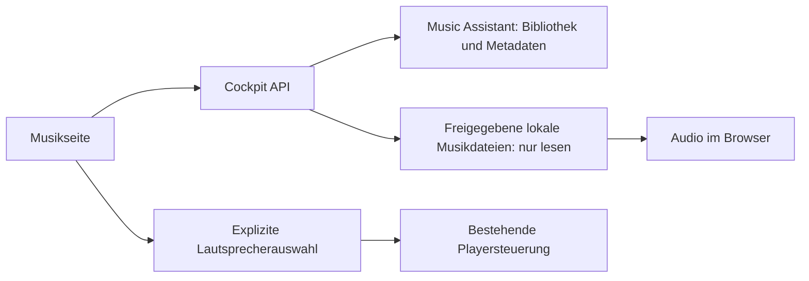

# Eine Bibliothek, zwei Wiedergabeziele

Das Cockpit zeigt eine Bibliothek mit Titel-, Album- und Ordneransicht. Eine
Titelauswahl für einen Lautsprecher löst keinen Wiedergabebefehl aus; der
bestehende Player mit seiner bestätigten Queue bleibt maßgeblich. „Auf diesem
Gerät“ nutzt dagegen ausschließlich das Audioelement des Browsers.

## Bibliotheksvertrag

`GET /api/music/albums?q=&offset=0` liefert lokale Alben in Seiten von 50
Einträgen. `GET /api/music/folders?path=&q=&offset=0` öffnet die ausdrücklich
konfigurierte Filesystem-Instanz und deren direkte Unterordner. Eine leere
Providerbindung erlaubt keinen globalen Browse-Aufruf. Die Ordnersuche filtert
die aktuell geöffnete Ebene; Titel- und Albumsuche nutzen die MA-Bibliothek.
Auch ein bloßer Domainname wie `filesystem_local` genügt für Alben und Ordner
nicht: Dort ist eine konkrete Instanz wie `filesystem_local--Instanz-ID` nötig.
Die ältere Titelsuche behält ihre bisherige Domain-Unterstützung; bei mehreren
Quellen darf die neue Ordneransicht jedoch keine beliebige Instanz auswählen.

`GET /api/music/collection?uri=…` liefert eine geordnete Titelliste. Bei Alben
sind dies die in MA indexierten Bibliothekstitel (`in_library_only=True`), keine
Garantie über unbekannte Dateien oder eine externe Diskografie. Ordner werden
rekursiv gelesen. Höchstens 1000 Titel, 100 Ordner und 20 Unterebenen sind
zulässig. Ein Zeitbudget von 20 Sekunden wird vor und nach MA-Aufrufen geprüft;
ein bereits laufender Aufruf hat weiterhin maximal 8 Sekunden Transportzeit.
Grenzüberschreitungen oder ungeklärte Einträge liefern einen Fehler statt einer
unbemerkt verkürzten Warteschlange. Playlistdateien innerhalb einer
Ordnersammlung werden derzeit ebenfalls kontrolliert abgewiesen, weil ihre
vollständige lokale Zuordnung nicht geprüft ist.

Suchantworten dürfen eine neuere Auswahl nicht überschreiben. Eine vorbereitete
Ordnerqueue nennt ihren ursprünglichen Namen und Pfad auch nach Navigation.
Der Start bleibt ausdrücklich. Suchen ändert eine bereits laufende Browserqueue
nicht. Fehlerhafte Audioformate werden angezeigt und nicht still übersprungen.

## Browseraudio

Die Add-on-Optionen `music_browser_root` (absolutes Verzeichnis) und
`music_browser_allow_playback` (standardmäßig `false`) richten Browseraudio ein.
`music_assistant_library_provider` muss dafür eine konkrete
`filesystem_local--…`-Instanz sein. Der Verzeichnisinhalt muss exakt dieselbe
Wurzel wie diese MA-Instanz haben. Die zusätzliche HA-Einbindung `media:ro`
stellt Medien ausschließlich lesend bereit; sie benötigt eine gesonderte
produktive Installationsfreigabe. Bestehende MA-/Gerätefreigaben werden nicht
automatisch geändert.

`GET /api/music/browser-status` meldet die Verfügbarkeit ohne Pfade oder
Zugangsdaten. `GET`/`HEAD /api/music/audio?uri=…` prüft den Titel erneut über MA
und öffnet nur eine reguläre lokale Audiodatei unter der konfigurierten Wurzel.
Jede Pfadkomponente wird über einen bereits geöffneten Verzeichnisdeskriptor
geöffnet; Symlinks werden abgewiesen. Diese Schutzfunktion benötigt POSIX
`dir_fd`/`O_NOFOLLOW`; auf nicht unterstützten Plattformen bleibt Browseraudio
gesperrt. Einzelne Byte-Ranges unterstützen Springen im Titel, die Übertragung
erfolgt in 64-KiB-Blöcken. Mehrfachbereiche liefern HTTP 416.
Datei- oder Verbindungsfehler nach Beginn einer Audioantwort beenden die
Verbindung; es wird keine zweite JSON-Antwort an einen begonnenen Audiostream
angehängt. Betriebssystemfehler mit privaten Dateinamen werden nicht ausgegeben.

Der Audiopfad und der private MA-Konfigurationshandoff bleiben getrennte
Sicherheitsgrenzen. Der Handoff liest eine feste, größen- und berechtigungsgeprüfte
Konfigurationsdatei beim Start; Browseraudio traversiert wechselnde Musikpfade
pro Anfrage. Ihre ähnlichen `O_NOFOLLOW`-Prüfungen werden deshalb nicht in einen
gemeinsamen Loader mit gemischten Konfigurations- und Medienrechten verlagert.

Es gibt keinen neuen Listener und keine rohen MA-Stream-URLs. Audio und
Metadaten laufen über denselben geschützten Cockpit-Ursprung. Cross-Origin wird
abgewiesen; Range-Antworten erlauben kein Caching außerhalb des privaten
Zugriffskontexts. Die vorhandene Zugangssicherung ist weiterhin Voraussetzung.
Ein Browserklick ist erforderlich. Ob ein Format auf einem konkreten Handy
abspielbar ist und wie Hintergrundwiedergabe funktioniert, hängt zusätzlich vom
Browser ab und wird erst bei einer freigegebenen Geräteabnahme bestätigt.

## Quellenabgleich und Veröffentlichung

Der Integrationsstand `0.1.18` führt den Bibliotheksausbau mit Cockpit `0.1.17`
zusammen. Lumis signierte Sprachantworten, Raum-Musikaktionen, Temperaturstatus,
Raumzieloptionen und Schutz gegen doppelte Aufträge bleiben erhalten. Ein
konfigurierbares MA-Zeitlimit bleibt zusätzlich zu den Bibliotheksmethoden
verfügbar. `codex_control.py` und `home_assistant.py` stammen aus der geprüften
Lumi-Konsolidierung vom 17.10.2026; deren relevante laufende Steuerungsdateien
wurden gegen den Export v4 vom 16.10. lesend per Prüfsumme abgeglichen.

Der Host-Port bleibt standardmäßig gesperrt. Der vorhandene geschützte Zugang
muss auch die neuen Metadaten- und Audiorouten abdecken. `Origin`-Prüfungen sind
keine Benutzeranmeldung. Die Konfiguration bleibt für Browseraudio zunächst
gesperrt; konkreter Medienpfad und lesende Einbindung müssen auf HA geprüft
sein. Installationsvorbereitung und Rückweg stehen in
[Installationsplan](music-library-installation.md). Ein Draft-PR allein ist keine
Installationsfreigabe.

Die verwendeten MA-Bibliotheksaufrufe wurden gegen den öffentlichen Source Tag
[2.10.5](https://github.com/music-assistant/server/tree/2.10.5) geprüft. Die
[MA-Streamrouten](https://github.com/music-assistant/server/blob/2.10.5/music_assistant/controllers/streams/controller.py)
sind an eine Player-Queue gebunden und werden hier nicht als Browser-URL benutzt.
