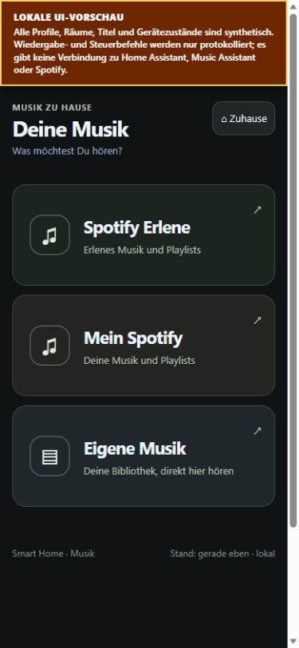
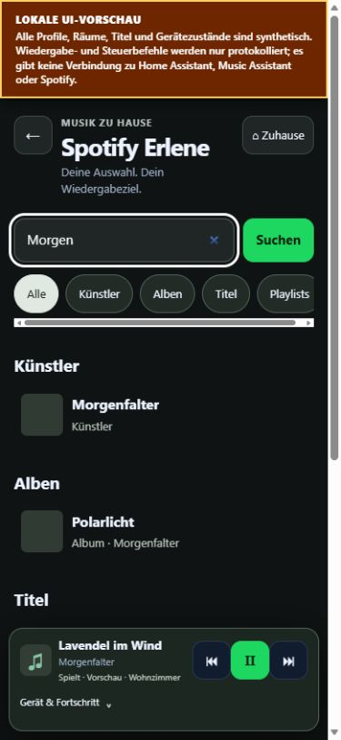
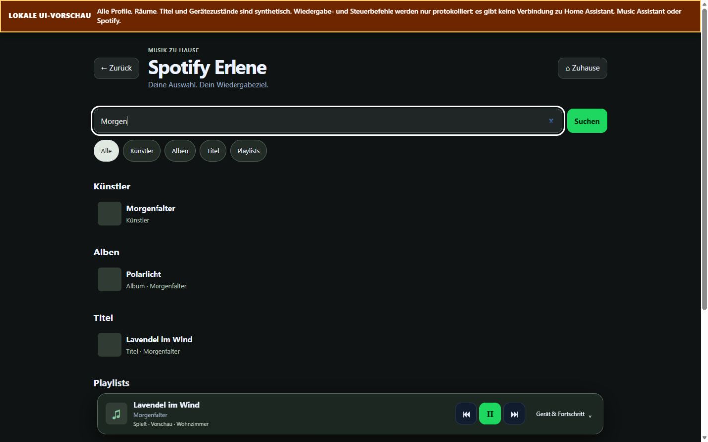

# Einfachere Musikoberfläche

Die Startseite bietet Spotify Erlene, Mein Spotify und Eigene Musik. Eine
Quelle öffnet Suche und Player; Haussteuerung bleibt unter „Zuhause“ erreichbar.
Die folgenden Bildschirmaufnahmen zeigen ausschließlich synthetische Daten.

## Bedienung und Grenzen

Suchvorschläge erscheinen nach 300 ms Eingabepause. Spotify unterscheidet
Künstler, Alben, Titel und Playlists; die eigene Bibliothek Künstler, Alben und
Titel. Kategorien können gefiltert werden. Lokale Künstler öffnen ihre
validierten Inhalte ohne Wiedergabestart. Die Vorschläge der eigenen Musik
bleiben auf sechs je Kategorie begrenzt; Filter und Pagination erschließen die
weiteren Treffer. Spotify Bridge 0.1.20 verteilt ihr Gesamtlimit gleichmäßig
auf verfügbare Inhaltstypen, statt andere Typen durch Titel zu verdrängen.

Navigation und Zielauswahl verändern laufende Wiedergabe nicht. Browseraudio
bleibt als „Dieses Gerät“ gekennzeichnet. Bei Auswahl eines Lautsprechers bleibt
ein vorhandener Browserplayer unter „Mehr“ erreichbar. Spotifykonten werden
eindeutig an geprüfte Namen und stabile IDs gebunden. Fehlende oder mehrdeutige
Profile werden gesperrt, nicht durch ein anderes Konto ersetzt.

## Prüfung am 17.10.2026

| Prüfung | Ergebnis |
|---|---|
| UI-Suiten | 90 bestanden |
| Cockpit-Server/Lumi-Regressionen | 151 Tests, davon 3 plattformbedingte Auslassungen |
| Spotify-Bridge-Suiten | 90 bestanden |
| Spotify-Suche: 360/390/430/1440 px | Kein horizontaler Seitenüberlauf; sichtbare Buttons mindestens 44 px hoch |
| Spotify-Player | Mobil rund 118 px, Desktop rund 83 px im eingeklappten Zustand |
| Synthetische API-Vorschau | Künstler, Sammlungen, Suchkategorien, Audio-HEAD/Range und Zielbindung geprüft |

Normales lesendes Claude-Review wurde versucht; die CLI meldete ein
Nutzungslimit. Stattdessen erfolgten ein gekennzeichnetes Codex-Selbstreview und
eine zusätzliche unabhängige Integrationsprüfung. Zwei konkrete Regressionen
wurden behoben und getestet: Quellenwechsel beendeten zuvor die optionale
Spotify-Browservorschau; außerdem blieb beim Legacy-Fallback der Startcontainer
verborgen. Lumi-Steuerungsdateien, Zugangsdaten, Rechte und produktive Dienste
wurden nicht verändert.

Die abschließende Sichtprüfung des nochmals verkleinerten Browserplayers und
der erneute Browseraudio-Test nach Korrektur des synthetischen Vorschau-Servers
sind noch offen: Die Browserverbindung lieferte wiederholt Timeouts.
Die Versionsstände Cockpit 0.1.19 und Spotify Bridge 0.1.20 sind vorbereitet;
eine produktive Installation ist nicht erfolgt.

## Umsetzung und Referenzen

Zwei Standard-Worker übernahmen Shell/Spotify und Bibliothek/Künstlerzugang
(gpt-6.1-sol, medium); ein Fast-Worker den isolierten Vorschau-Server
(gpt-6-luna, low). Codex übernahm Schnittstellenentscheidungen, Integration,
Spotify-Trefferverteilung, Regressionstests, visuelle Prüfung und Veröffentlichung.
Die ältere SmartHome-Quellkopie wurde nicht überschrieben. Maßgeblich ist diese
Home-Assistant-Distribution.

Das Suchmuster orientiert sich an der offiziellen
[Spotify-Suche](https://support.spotify.com/ie/article/search/) und
[Suchvervollständigung](https://support.spotify.com/ie/article/search-autocomplete/).
Der lokale Künstlervertrag wurde gegen den
[Artist-Controller von MA 2.10.5](https://github.com/music-assistant/server/blob/2.10.5/music_assistant/controllers/music/media/artists.py)
geprüft. Die Darstellung ist eine eigene Implementierung der vertrauten
Bedienmuster.
